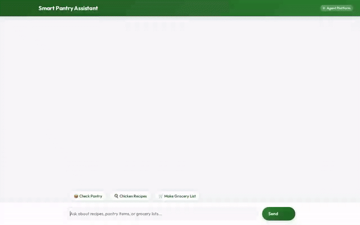

# 🥫 Smart Pantry Assistant

An agent-first recipe concierge and pantry inventory management system built with Google Cloud, the Agent Development Kit (ADK), and A2UI.



---

## 🌟 Capabilities & Implemented Features

Smart Pantry Assistant acts as an intelligent kitchen concierge that tracks pantry ingredients, discovers recipes, plans grocery lists, and generates culinary media:

- **🧠 Cross-Session Memory**: Powered by Vertex AI Memory Bank (`VertexAiMemoryBankService`), the agent automatically remembers user food preferences, dietary restrictions, and food allergies across sessions.
- **🗄️ Pantry & Recipe Database**: Stores and queries user pantry items and recipe collections using Google Cloud Firestore (`pantry_items` and `recipes` collections).
- **🎨 Generative Image Creation**: Generates food photography using Vertex AI model `gemini-3.1-flash-lite-image`. Saves rendered images to Playground Artifacts and uploads to a public Google Cloud Storage bucket.
- **🎬 Generative Video Creation**: Generates cooking videos using Vertex AI model `gemini-omni-flash-preview` in the `global` region. Saves rendered videos to Playground Artifacts and uploads directly to Cloud Storage.
- **🛍️ Grocery List Planning**: Cross-references recipe requirements against current pantry stock to generate automated missing-ingredient shopping lists.
- **🌐 Global Recipe Search**: Fetches external recipes from TheMealDB API when local recipes don't match.
- **📍 Grocery & Store Locator**: Geocodes locations and searches nearby grocery stores using Google Places API and Google Geocoding API.
- **🪟 Agent-First UI (A2UI)**: Renders structured UI cards (A2UI v0.8) for clean presentation of recipes, pantry cards, and media.

---

## 🏗️ Technical Architecture & Cloud Services

| Component / Feature | Powered By | Implementation Detail |
| --- | --- | --- |
| **Agent Reasoning Engine** | ADK (`google.adk`) | `Gemini(model="gemini-2.5-flash")` |
| **Long-Term Memory** | Vertex AI Memory Bank | `VertexAiMemoryBankService` |
| **Database** | Google Cloud Firestore | Document collections for pantry stock & recipes |
| **Media Storage** | Google Cloud Storage | Public bucket storage for generated images & videos |
| **Image Generation Tool** | Vertex AI | `gemini-3.1-flash-lite-image` |
| **Video Generation Tool** | Vertex AI | `gemini-omni-flash-preview` (`global` region) |
| **Structured Agent UI** | A2UI Framework | `A2uiSchemaManager` + `BasicCatalog 0.8` |
| **Places & Geocoding** | Google Maps Platform | Google Places API (New) & Geocoding API |
| **Frontend UI** | FastAPI & A2A Proxy | Clean HTML/CSS/JS interface with A2UI card renderer |

---

## 🚀 Setup & Execution Instructions

### 1. Prerequisites

- Python 3.11+
- Google Cloud SDK (`gcloud`) authenticated via Application Default Credentials:
  ```bash
  gcloud auth login
  gcloud auth application-default login
  ```

### 2. Install Dependencies

```bash
pip install -r requirements.txt
```

### 3. Run Agent Locally via ADK CLI

Run the agent locally using `agents-cli`:
```bash
agents-cli run --mode a2a
```

### 4. Run Web UI Frontend Locally

Navigate to the `frontend/` directory, set the agent configuration environment variables, and start the FastAPI proxy server:

```bash
cd frontend
export AGENT_ENGINE_RESOURCE_NAME="<YOUR_AGENT_ENGINE_RESOURCE_NAME>"
export AGENT_DIRECTORY="app"
python main.py
```

The web interface will start locally on port `8080`.
